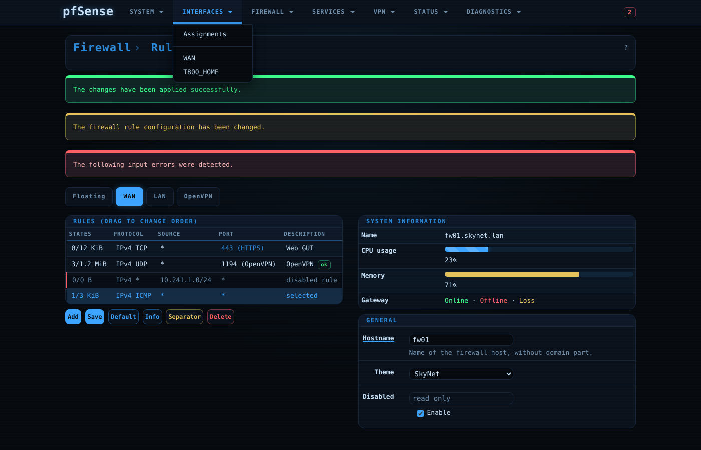

# PfSense-Skynet-Theme

Dunkles Theme für die pfSense-Weboberfläche im SkyNet-Stil – Farben, Schrift und
Bausteine stammen aus der Oberfläche von [ShareOS](https://github.com/UniqueDroid/ShareOS)
(abgeleitet vom Skynet-Intranet): Blau auf fast Schwarz, Monospace-Schrift,
feine Scanlines, leuchtende Akzente.



Die Vorschaubilder zeigen einen Nachbau der pfSense-Seitenstruktur, keine echte Firewall.

## Varianten

| Datei | Theme-Name in pfSense | Akzent |
|---|---|---|
| `css/SkyNet.css` | SkyNet | Blau (Standard) |
| `css/SkyNet-Green.css` | SkyNet-Green | Grün |
| `css/SkyNet-Red.css` | SkyNet-Red | Rot |
| `css/SkyNet-White.css` | SkyNet-White | Weiß |

## Installation ohne SSH

In pfSense **Diagnostics → Command Prompt** öffnen und unter *Execute Shell Command*
diese Zeile ausführen:

```sh
fetch -qo - https://raw.githubusercontent.com/UniqueDroid/PfSense-Skynet-Theme/main/install.sh | sh
```

Das Skript lädt die vier CSS-Dateien nach `/usr/local/www/css/` und ändert sonst nichts.

Danach das Theme auswählen: **System → General Setup → webConfigurator → Theme → SkyNet**, speichern.

Wer kein Skript aus dem Netz ausführen möchte, lädt nur die gewünschte Datei direkt:

```sh
fetch -o /usr/local/www/css/SkyNet.css https://raw.githubusercontent.com/UniqueDroid/PfSense-Skynet-Theme/main/css/SkyNet.css
```

Ohne Internetzugang der Firewall: CSS-Datei im selben Dialog unter *Upload File* hochladen
(landet in `/tmp`) und dann verschieben:

```sh
mv /tmp/SkyNet.css /usr/local/www/css/SkyNet.css
```

## Aktualisieren und Entfernen

Aktualisieren: die Installationszeile erneut ausführen, danach die Seite mit Strg+F5 neu laden.

Entfernen:

```sh
fetch -qo - https://raw.githubusercontent.com/UniqueDroid/PfSense-Skynet-Theme/main/install.sh | sh -s -- uninstall
```

Ist ein entferntes Theme noch ausgewählt, zeigt pfSense wieder das Standard-Theme.

## Gut zu wissen

- Ein pfSense-Update kann eigene Dateien in `/usr/local/www/css/` entfernen. Dann einfach
  die Installationszeile erneut ausführen – die Theme-Auswahl bleibt in der Konfiguration erhalten.
- Die Anmeldeseite hat ein eigenes Stylesheet und wird von Themes nicht verändert
  (Farbe dort: *System → General Setup → Login page color*).
- Die Schrift ist JetBrains Mono, wenn sie auf dem Rechner installiert ist, sonst die
  Monospace-Schrift des Systems. Es wird nichts aus dem Internet nachgeladen.
- Das Theme setzt auf `pfSense.css` der Firewall auf (`@import`) und überschreibt nur Farben,
  Schrift und Formen – Layout und Funktionen bleiben unverändert.

## Anpassen

Die Dateien in `css/` werden erzeugt. Regeln stehen in `src/base.css`, die Farben der
Varianten in `build.sh`:

```sh
sh build.sh
```

## Lizenz

GPL-2.0, siehe [LICENSE](LICENSE).
